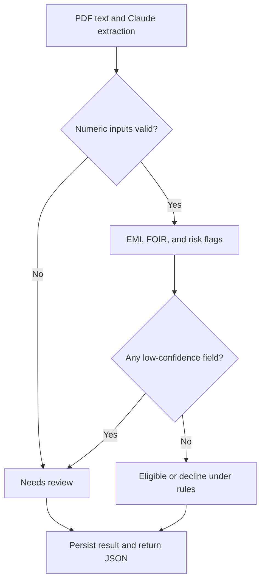

# LoanLens

## Overview

LoanLens is a portfolio prototype for extracting applicant information from loan application PDFs and applying affordability rules. A Large Language Model (LLM) extracts structured fields and confidence labels; Python validates the numeric inputs, calculates EMI and FOIR, and returns an eligibility, decline, or human-review outcome. Extracted fields, metrics, risk flags, and reasons are stored for inspection.

The rules are deterministic for the same inputs, but the inputs still depend on model extraction. This project demonstrates the workflow; it has not been validated for production lending.

---

**Tech Stack:** FastAPI, Pydantic v2, SQLAlchemy 2.0, Anthropic Claude (Structured Outputs), SQLite/PostgreSQL, pytest.

---

## Architecture

The PDF analysis path, after upload validation:



### Layer Responsibilities

* **Routes** orchestrate requests, map errors, and return API responses.
* **Services** contain application logic such as PDF extraction, LLM extraction, risk analysis, and decision routing.
* **Rules Engine** performs deterministic EMI, FOIR, and risk calculations.
* **Decision Router** applies deterministic business rules to determine eligibility, decline, or human review outcomes.
* **Database Layer** persists applications and decisions for auditability and retrieval.

The key design principle is that the LLM reads documents, while deterministic Python code makes decisions.

---

## How this was built

For the recent LoanLens improvements, I used Claude to create an
execution plan. I followed that plan, wrote part of the code myself, and used ChatGPT to help debug issues and generate some implementation and test code.

I applied the changes locally, ran the application and tests, and worked through failures with ChatGPT.

---

## Setup

### Requirements

* Python 3.11+
* Anthropic API key for live Claude extraction; imports, the JSON route, and mocked tests do not require one
* No external database required for local development (SQLite is the default)


### 1. Create and activate a virtual environment

**macOS / Linux**

```bash
python -m venv venv
source venv/bin/activate
```

**Windows**

```powershell
python -m venv venv
venv\Scripts\activate
```

### 2. Install dependencies

```bash
pip install -r requirements.txt
```

### 3. Configure environment variables for live extraction

Skip this step if you only want to run the mocked test suite. For live Claude extraction, copy the example environment file:

```bash
cp .env.example .env
```

Add your Anthropic API key:

```env
ANTHROPIC_API_KEY=your_api_key_here
```

Notes:

* `CLAUDE_MODEL` defaults to `claude-haiku-5-5` and can be overridden.
* `DATABASE_URL` defaults to SQLite.
* No database setup is required for local development.

### 4. Start the application

```bash
uvicorn app.main:app --reload
```

### 5. Open Swagger UI

```text
http://127.0.0.1:8000/docs
```

### 6. Run the test suite (optional)

```bash
pytest -q
```

---

## API Endpoints

### POST /api/v1/applications/analyze

Upload a loan application PDF and run the complete pipeline: extraction, confidence assessment, risk analysis, decisioning, and persistence.

### POST /api/v1/applications/analyze-fields

Submit applicant data directly as JSON and receive a lending decision without PDF processing.

### GET /api/v1/applications/{id}

Retrieve a previously stored loan application and decision by ID.

### GET /api/v1/review-queue

List applications that require manual review due to low-confidence extraction or workflow routing.

### GET /health

Health-check endpoint used to verify service availability.

---

## Demo

1. Start the API.
2. Open Swagger UI at:

```text
http://127.0.0.1:8000/docs
```

3. Use the `POST /api/v1/applications/analyze` endpoint.
4. Upload:

```text
sample_data/sample_application.pdf
```

5. Execute the request and inspect the returned extraction results, risk metrics, and lending decision.

---

## Testing

LoanLens has automated tests for the rules engine, decision routing, API behavior, persistence, PDF processing, and extraction error handling.

LLM-dependent tests mock the Claude call, so the suite does not need an API key or make paid model requests. `tests/conftest.py` sets a temporary SQLite database before app imports, keeping test writes out of the development database. `pytest.ini` restricts collection to `tests/`.

Regression tests cover missing and out-of-range extracted numeric values, field-specific review reasons, and valid boundary values such as zero existing EMIs. They check that validation failures bypass EMI and FOIR calculations. The JSON route rejects schema-invalid input with HTTP 422; the PDF route sends the covered missing or invalid extracted values to human review.

Run the test suite with:

```bash
pytest -q
```

To reproduce a run without an API key or local `.env` loading on macOS/Linux:

```bash
env -u ANTHROPIC_API_KEY -u PYTHONPATH PYTHON_DOTENV_DISABLED=1 pytest -q
```

GitHub Actions is configured to run the suite on pushes and pull requests without API secrets. The badge links to the workflow's current status.

Extraction quality is evaluated separately by `eval/run_eval.py`, which calls Claude on text samples and compares extracted values with expected JSON. It needs a configured API key and incurs API costs. Its current three samples are a small sanity check, not a representative benchmark.

---

## Known gaps

* **Blocking model call:** The async upload route calls the synchronous Anthropic client directly. The network wait blocks that worker's event loop and can delay other requests. PDF parsing also runs synchronously in the route. Nonblocking execution and concurrency checks remain planned.
* **No application-level upload size limit:** The route reads the entire upload with `await file.read()` before processing. Content-type and PDF-header checks do not limit file size or processing work. Large uploads can consume excessive memory and processing time; bounded reads and processing limits remain planned.
* **Review policy is broader than the earlier README described:** `has_low_confidence()` checks every extracted field, including `name`, `employer`, and `purpose`, rather than only critical financial fields. Any `low` confidence triggers review; `medium` alone does not. This can send otherwise usable applications to review. This README now describes the implemented behavior; defining and testing the intended critical-field policy remains planned.
* **Only three evaluation samples:** `eval/samples/` contains a clean application, a missing-income case, and a tricky-number-format case. These are text inputs, so the harness does not measure PDF parsing quality. This set is too small to establish real-world extraction accuracy or robustness. A broader labelled evaluation set and measured quality, latency, and cost results remain planned.

Phases B–D are planned to address these gaps. They are not implemented by this README update.

---

## Design Decisions

### Why split LLM extraction from the rules engine?

LoanLens separates document understanding from rule execution. The LLM extracts structured fields, while Python validates inputs and performs affordability calculations and decision routing. The rules engine and decision router can be tested without FastAPI, a database, or the LLM SDK. This makes rule behavior inspectable and reproducible for a given input, but an incorrect extraction can still change the outcome.

The architectural seam is explicit: `extract_fields()` produces structured applicant data, `analyze_applicant()` computes risk metrics, and `route_decision()` determines the final outcome.

---

### Why use per-field confidence instead of simply trusting the LLM?

Structured Outputs guarantee that the response matches a valid schema, but they do not guarantee that the extracted values are correct. For example, a model may return a valid monthly income field while still misreading the document. To address this, every extracted field carries its own confidence assessment using typed field wrappers and a confidence enum.

The confidence values are treated as routing signals rather than calibrated probabilities. The system uses `has_low_confidence()` to detect uncertain extractions and route them for human review. This approach acknowledges uncertainty explicitly instead of assuming that schema-valid output is always trustworthy.

---

### Why route applications to human review instead of auto-deciding everything?

The current confidence policy checks every extracted field. Any field with `low` confidence produces a `NEEDS_REVIEW` outcome, even when the available numeric data would otherwise produce eligibility or decline. A `medium` confidence label alone does not trigger review.

Missing or invalid critical numeric values also trigger review and skip calculations. These fields are `age`, `monthly_income`, `existing_emis`, `requested_amount`, and `tenure_months`. Review reasons name the failing fields. Invalid model output may be an extraction mistake, so it is flagged for a person to check rather than used as the sole basis for decline. The review queue exposes these applications for inspection.

The rationale for this behavior, the model choice, and omitted sampling parameters is recorded in [docs/DECISIONS.md](docs/DECISIONS.md).

---

### Why use FOIR and EMI as the primary affordability checks?

FOIR (Fixed Obligation to Income Ratio) and EMI (Equated Monthly Installment) are widely used affordability measures in consumer lending. Together they provide a simple, explainable way to evaluate whether an applicant can reasonably service a proposed loan.

The thresholds are demonstration policy assumptions. `FOIR_THRESHOLD`, `MINIMUM_MONTHLY_INCOME`, and `LOAN_INCOME_MULTIPLE` are defined in `rules_engine.py`; the default annual interest rate is currently `12.0` in `analysis.py`. They are code-level settings, not a policy-management interface or a validated lender policy.

---

### What are the primary failure modes and how does the system handle them?

The first failure mode is LLM unavailability. If the extraction API fails, the extraction layer acts as a fault boundary. Rather than raising an exception that causes a server error, the system returns a low-confidence extraction result and logs the failure. The application is then routed to human review. This converts an infrastructure failure into a recoverable workflow outcome.

The second failure mode is incorrect or uncertain extraction. Low confidence with valid numeric values still allows EMI and FOIR calculations, while routing the case for review. Missing critical numeric values produce `MISSING_CRITICAL_FIELD`; values outside the implemented bounds produce `INVALID_VALUE`. Both skip calculations and produce field-specific review reasons. The current response uses `0.0` metric placeholders when calculations are skipped; these are not calculated affordability results.

The third failure mode is document quality. Scanned or image-only PDFs that contain no extractable text trigger a `NoExtractableTextError` and return a 422 response. A production implementation would extend this path with OCR processing.

The fourth failure mode is invalid uploads. The API checks the declared content type and the `%PDF-` header, returning HTTP 400 when either check fails. These checks do not establish that the full PDF is well-formed or safe to process, and there is no application-level size limit yet.

The final failure mode is prompt injection within uploaded documents. The extraction prompt tells the model to treat document content as data and ignore embedded instructions. The model cannot edit the Python rules, but manipulated extracted values can still influence the inputs those rules receive. Separating extraction from decisions limits the model's role; it does not guarantee protection against prompt injection.

---

### What would change for production deployment and scaling?

Production work would first address the blocking execution path, resource limits, and evaluation gaps above. A worker queue could move extraction out of the request handler, with a job identifier and a way to retrieve processing status and results. That architecture is not implemented in the current version.

The rules engine and decision router are pure functions, but end-to-end scaling also depends on database concurrency, model rate limits, and worker capacity. SQLite is the local default; using shared PostgreSQL would require configuration and integration testing. Monetary calculations currently use floating-point arithmetic; a move to `Decimal` would need explicit rounding rules and tests.

Additional production improvements would include OCR support for scanned documents, idempotency keys for safe retries, structured audit logging, centralized secret management with rotation, encryption of sensitive applicant data at rest, and careful review of LLM-provider retention policies such as zero-data-retention configurations.

---

[](https://github.com/Rushabh-15/LoanLens/actions/workflows/tests.yml)